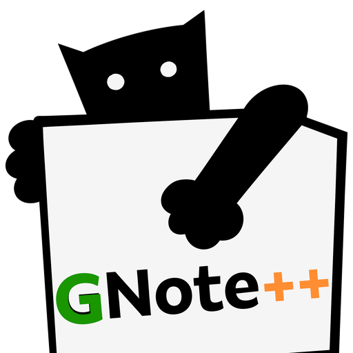
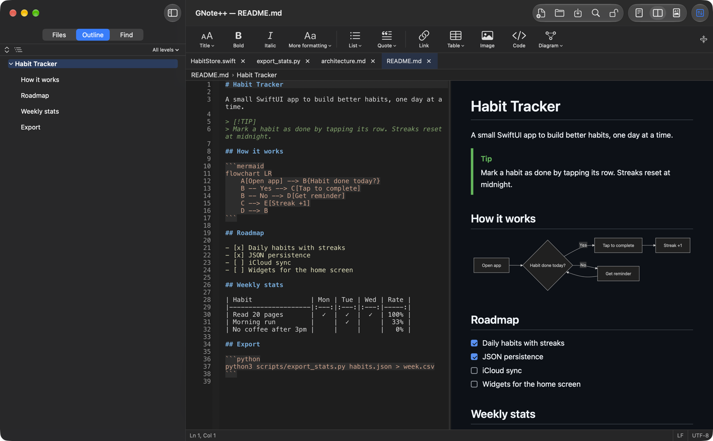
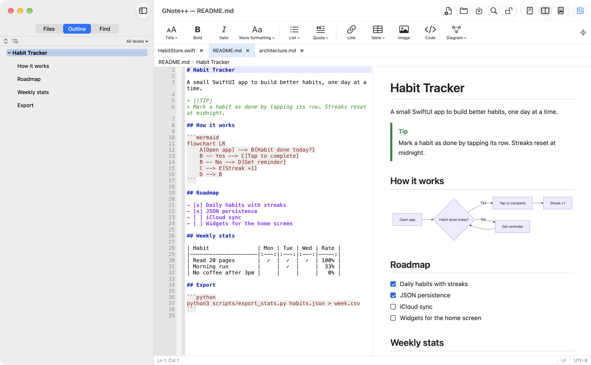
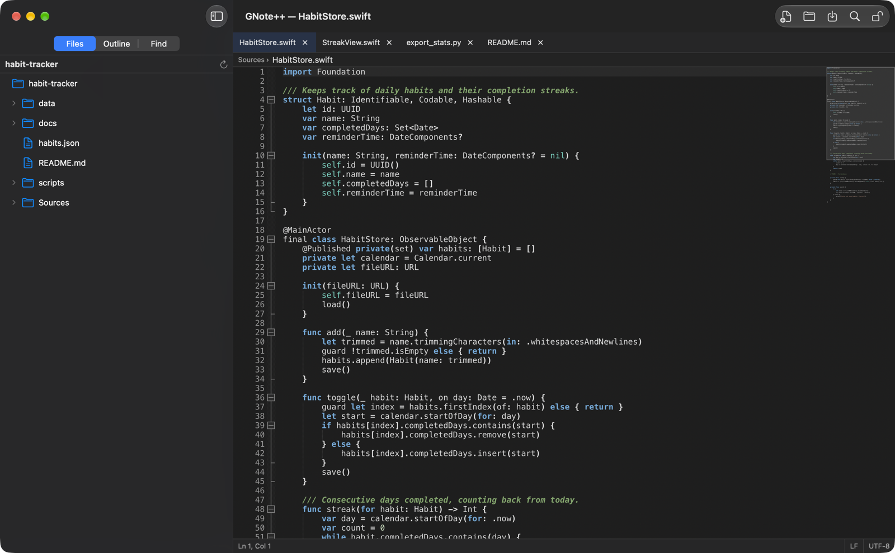
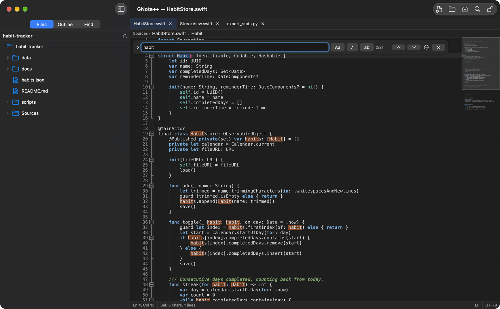
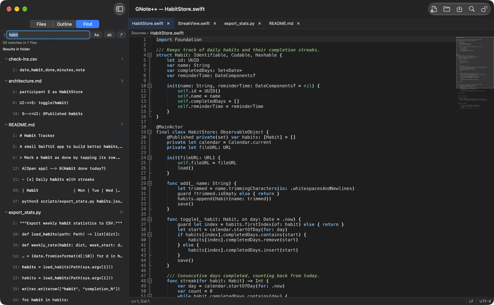
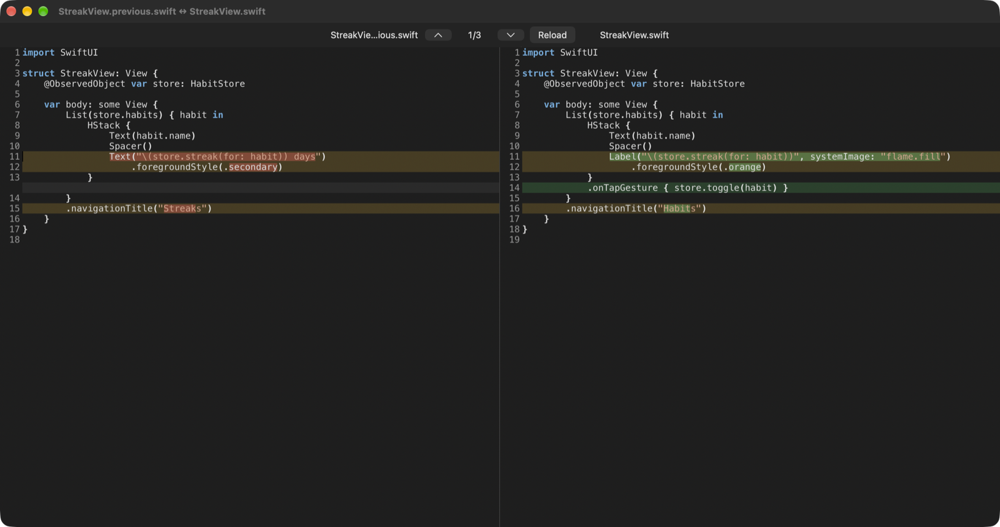
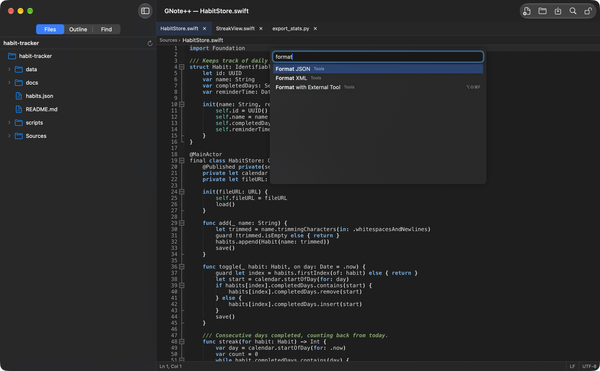
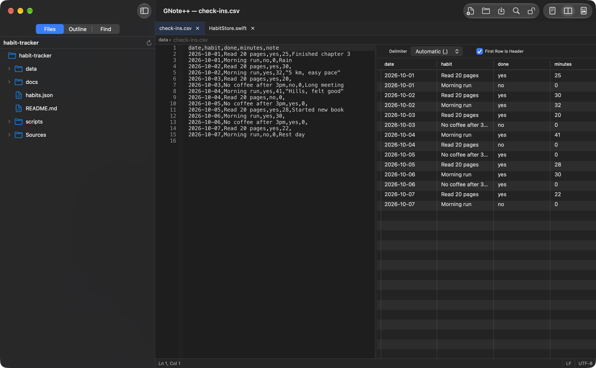

<p align="center"></p>

# GNote++ — Markdown and code editor for macOS

[](https://github.com/jcubillosz/gnote-plus-plus/releases/latest)


[](LICENSE)
[](https://www.paypal.com/ncp/payment/ARSKH5DQC8WAL)

**English** · [Español](#español) · [Website](https://jcubillosz.github.io/gnote-plus-plus/)

GNote++ is a free, open-source **Markdown and code editor for Mac**, built on
the source code of [Notepad++](https://notepad-plus-plus.org/). Write **AI
prompts, docs and web content** with a live preview and **Mermaid diagrams**,
on top of the [Scintilla](https://www.scintilla.org/) editing engine and the
syntax highlighting of every Notepad++ language. A native SwiftUI app — no
Wine, no emulation. Signed and notarized by Apple.

**[Download GNote++ for macOS (.dmg)](https://github.com/jcubillosz/gnote-plus-plus/releases/latest)**



## Who it's for

- **Prompt engineers** — system prompts, prompt libraries, `CLAUDE.md` and
  `AGENTS.md` are Markdown. See them rendered as you write, navigate them from
  the outline, sketch agent flows in Mermaid, and lock a finished prompt
  against accidental edits.
- **Web and content editors** — posts and pages for Markdown-based sites;
  pasted images are saved next to the file; GitHub-style preview.
- **Technical writers** — READMEs, runbooks and docs with alerts, task lists,
  diagrams (PNG/SVG export) and PDF export.
- **Developers** — every Notepad++ language, regex search, find in files,
  multi-cursor editing, minimap.

## Markdown, done properly

- **Editor, split or preview-only view**; double-click the preview to jump to
  the source line.
- **GitHub Flavored Markdown**: tables, task lists you can tick in the preview,
  alerts (`> [!NOTE]`, `[!WARNING]`…), strikethrough, autolinks.
- **Mermaid diagrams** (flowchart, sequence, class, state, Gantt, pie, mind
  map…) with templates; export as PNG or SVG.
- **Formatting toolbar, compact or large**: the large one works like a word
  processor — big icons with labels, dropdowns with live samples (heading
  sizes, list types, alert colours) and a grid to pick the table size.
  Links, highlight, keyboard keys, footnotes, collapsible sections; ⌘B, ⌘I,
  ⌘K.
- Syntax-highlighted code blocks in the preview, list continuation, table
  formatting (⌥⌘T), image paste and drag-and-drop.
- Heading outline in the sidebar; print and PDF export; spell checker (English
  and Spanish).
- **Private by design**: the preview runs no JavaScript and diagrams render
  offline.



## And a full code editor

- **Syntax highlighting** for every language Notepad++ supports, with its same
  definitions and color themes; light and dark mode.
- Bookmarks, code folding, change history, brace and tag matching, smart
  highlight, **multi-cursor and column editing**, autocompletion, line
  operations, function list, **minimap**.
- **Auto-indent** as you type (braces, Python, HTML/XML), **reindent** a file
  or selection, and closing brackets that step over instead of doubling.
- **Format and minify JSON** (key order preserved), **format XML**, MD5/SHA
  hashes and Base64 in the Tools menu.
- **Find and replace** with regular expressions, plus **find in files** across a
  folder.
- **Encoding and line-ending detection** (UTF-8, Latin-1, CRLF…) preserved on
  save; tabs, file tree, session restore, reload of files changed on disk.
- Interface in English and Spanish.







## Tools for developers

- **Compare files** side by side with in-line changes: against the last git
  commit, the saved version or another tab.
- **Git built in**: added/modified/deleted lines in the gutter (click to revert
  a block), file status in the tree, inline blame.
- **Command palette** (⇧⌘P) and **Quick Open** (⌘T) with fuzzy search,
  `:line`, `@symbol` and project-wide symbols.
- **Replace in files**, **snippets** with Tab, **macros**, clipboard history,
  column editor and continuous backup of unsaved changes.
- **Web**: HTML live preview, Emmet, tag auto-close and rename, CSS color
  swatches, JWT/URL/HTML entity/timestamp tools.
- `.editorconfig`, external formatters (Prettier, Black, swift-format…),
  breadcrumbs, sticky scroll, a live **regex tester** and a **CSV/TSV table
  view**.







## How it differs from Notepad++

| | Notepad++ | GNote++ |
|---|---|---|
| Runs on | Windows | macOS, native app |
| Markdown | Syntax highlighting; preview via third-party plugins | Built-in live preview, Mermaid, outline, toolbar, PDF export |
| Languages and themes | Notepad++ definitions | The same definitions and themes |
| Editing engine | Scintilla | Scintilla |
| License | GPL-3.0, free | GPL-3.0, free |

GNote++ is not affiliated with or endorsed by Notepad++.

## What's new in 1.5.0

- **Compare files** side by side, with in-line change highlights and synced
  scrolling: against the last git commit (⌃⌘K), the saved version (⌃⇧⌘K) or
  another tab.
- **Built-in git**: added, modified and deleted lines in the gutter (click to
  revert a block), file status in the file tree and inline blame (⌃⌘L). Never
  triggers the command line tools install prompt.
- **Command palette** (⇧⌘P) with every menu command, and **Quick Open** (⌘T)
  with fuzzy search over open, recent and project files; `:line` and `@symbol`
  to jump, `#` for project-wide symbols.
- **Replace in files** (⇧⌘H) with a preview count; **find all** and **mark**
  matches.
- **Code snippets** that expand with Tab, with placeholder fields, and
  built-in examples for Swift, JS/TS, Python, HTML and Markdown (⌃⌘I).
- **Web tools**: HTML live preview, auto-close and rename of tags, Emmet
  abbreviations (Tab), CSS color swatches with a color picker, and URL, HTML
  entities, JWT and timestamp tools.
- **For developers**: `.editorconfig` support, external formatters (Prettier,
  Black, swift-format…, ⌥⇧⌘F), symbol breadcrumbs above the editor and sticky
  scroll that keeps the current function in view.
- **Live regular expression tester** (⌃⌘X) with groups and a warning for slow
  patterns.
- **CSV/TSV table view** (⌃⌘T): aligned columns, sort and copy columns, or
  sort the file by a column.
- **Macros** (record and play back), **column editor** (⌥⌘C), **clipboard
  history** (⌘⇧V) and **continuous backup**: unsaved changes survive even if
  the app quits.
- **Collapsible outline**: fold each section, collapse or expand all, and show
  up to a heading level.
- Fixes: the app could hang on launch while restoring the session; the find
  bar slid under the sidebar in narrow windows.

[Full release history](https://jcubillosz.github.io/gnote-plus-plus/changelog/)

## Support the project

GNote++ is free and built in spare time. If it saves you time, a
[donation via PayPal](https://www.paypal.com/ncp/payment/ARSKH5DQC8WAL)
helps keep it maintained and pays for the Apple developer account that lets it
open without security warnings.

---

## Español

GNote++ es un **editor de Markdown y código, gratuito, de código abierto para
macOS**, basado en el código fuente de [Notepad++](https://notepad-plus-plus.org/).
Pensado para escribir **prompts de IA, documentación y contenido web** con
vista previa en vivo y **diagramas Mermaid**, sobre el motor de edición y el
coloreado de sintaxis de Notepad++.

No es un port de la interfaz Win32 ni una capa de compatibilidad: la UI está
escrita de cero en SwiftUI y usa [Scintilla](https://www.scintilla.org/) como
componente de edición. Lo que se reutiliza de Notepad++ es su lógica de datos —
la detección de codificación (uchardet) y las definiciones de lenguajes y temas
(`langs.model.xml`, `stylers.model.xml`).

[Sitio web en español](https://jcubillosz.github.io/gnote-plus-plus/es/) ·
[Donar con PayPal](https://www.paypal.com/ncp/payment/ARSKH5DQC8WAL)

---

## Descargar

**[GNote++.dmg — v1.5.0](releases/v1.5.0/GNote++.dmg)** (también en
[Releases](https://github.com/jcubillosz/gnote-plus-plus/releases/tag/v1.5.0)).
Firmado con Developer ID y notarizado por Apple — se abre sin advertencias de
Gatekeeper.

### Novedades en 1.5.0

- **Comparar archivos** lado a lado, con los cambios marcados dentro de cada
  línea y desplazamiento sincronizado: con la última versión de git (⌃⌘K), con
  la versión guardada (⌃⇧⌘K) o con otra pestaña.
- **Git integrado**: marcas de líneas agregadas, modificadas y borradas en el
  margen (clic para restaurar un bloque), estado de cada archivo en el árbol y
  blame en línea (⌃⌘L). Nunca muestra el aviso de instalar herramientas de
  línea de comandos.
- **Paleta de comandos** (⇧⌘P) con todos los comandos de los menús y **abrir
  rápido** (⌘T) con búsqueda aproximada en archivos abiertos, recientes y del
  proyecto; `:línea` y `@símbolo` para saltar, `#` para símbolos de todo el
  proyecto.
- **Reemplazar en archivos** (⇧⌘H) con recuento previo; **buscar todo** y
  **marcar** coincidencias.
- **Fragmentos de código** (snippets) que se expanden con Tab y campos para
  completar, con ejemplos para Swift, JS/TS, Python, HTML y Markdown (⌃⌘I).
- **Funciones web**: vista previa de HTML, autocierre y renombrado de
  etiquetas, abreviaturas Emmet (Tab), muestras de color CSS con selector y
  herramientas para URL, entidades HTML, JWT y timestamps.
- **Para programadores**: soporte de `.editorconfig`, formateadores externos
  (Prettier, Black, swift-format…, ⌥⇧⌘F), ruta de símbolos sobre el editor y
  encabezado fijo con la función actual al desplazarse.
- **Probador de expresiones regulares** en vivo (⌃⌘X), con grupos y aviso de
  patrones lentos.
- **Vista de tabla para CSV/TSV** (⌃⌘T): columnas alineadas, ordenar y copiar
  columnas, u ordenar el archivo por una columna.
- **Macros** (grabar y reproducir), **editor de columna** (⌥⌘C), **historial
  del portapapeles** (⌘⇧V) y **respaldo continuo**: los cambios sin guardar se
  recuperan aunque la app se cierre.
- **Esquema plegable**: plegar cada sección, plegar o desplegar todo y
  mostrar hasta un nivel.
- Arreglos: la app podía quedar colgada al abrir restaurando la sesión; la
  barra de búsqueda quedaba bajo el panel lateral con la ventana angosta.

[Historial completo de versiones](https://jcubillosz.github.io/gnote-plus-plus/es/changelog/)

## Qué hace

- **Editor Scintilla** con pestañas, árbol de archivos y temas claro y oscuro
  que siguen al sistema.
- **Coloreado de sintaxis** para todos los lenguajes de Notepad++, usando sus
  mismas definiciones y paletas, con negrita y cursiva.
- **Codificación y fin de línea**: se detectan al abrir y se conservan al
  guardar. Un archivo Latin-1 con CRLF se guarda como Latin-1 con CRLF.
- **Buscar y reemplazar** con expresiones regulares, coincidencia de
  mayúsculas, palabras completas, wrap-around y resaltado de todas las
  coincidencias.
- **Markdown**: coloreado en el editor y vista previa en vivo compatible con
  GitHub Flavored Markdown (tablas, listas de tareas, tachado, autolinks,
  alertas), renderizada con [cmark-gfm](https://github.com/github/cmark-gfm);
  **diagramas Mermaid** con exportación a PNG/SVG, esquema del documento e
  impresión/PDF.
- **Barra de formato compacta o grande**: la grande funciona como un
  procesador de texto, con íconos y nombre, desplegables con muestras
  (títulos, listas, alertas) y una cuadrícula para elegir el tamaño de la
  tabla.
- **Indentación automática** al escribir, **reindentar**, autocierre que pasa
  por encima del cierre, **formatear JSON y XML**, multicursor, marcadores,
  plegado, minimapa y buscar en archivos.
- Ir a la línea o a una posición, archivos recientes, restaurar la última
  pestaña cerrada, renombrar archivos.
- Interfaz en **español e inglés**, siguiendo el idioma del sistema.

## Requisitos

- macOS 13 o superior
- Xcode Command Line Tools (para compilar)

## Compilar

No hay proyecto de Xcode: es un paquete de Swift Package Manager.

```bash
cd mac/NppMacPOC
swift build
./scripts/make_app_bundle.sh
open .build/GNote++.app
```

`make_app_bundle.sh` arma el `.app` a mano a partir del binario de SwiftPM y lo
firma ad-hoc, que es lo que exige arm64 para poder ejecutarlo.

> El paquete alcanza `PowerEditor/`, `lexilla/` y `scintilla/` por symlinks
> relativos, así que hay que clonar el repositorio completo. Compilar solo la
> carpeta `mac/` no funciona.

## Créditos

GNote++ existe gracias al trabajo de otros:

| Componente | Autor | Licencia |
|---|---|---|
| [Notepad++](https://github.com/notepad-plus-plus/notepad-plus-plus) | Don Ho | GPL-3.0 |
| [Scintilla](https://www.scintilla.org/) · [Lexilla](https://www.scintilla.org/Lexilla.html) | Neil Hodgson | HPND |
| [uchardet](https://www.freedesktop.org/wiki/Software/uchardet/) | Mozilla · Free Software Foundation | MPL-1.1 |
| [pugixml](https://pugixml.org/) | Arseny Kapoulkine | MIT |
| [cmark-gfm](https://github.com/github/cmark-gfm) | John MacFarlane · GitHub | BSD-2 |
| [Boost.Regex](https://www.boost.org/doc/libs/release/libs/regex/) | John Maddock | BSL-1.0 |
| [Mermaid](https://mermaid.js.org/) | Knut Sveidqvist y colaboradores | MIT |

GNote++ no está afiliado a Notepad++ ni cuenta con su respaldo, y no usa su
nombre, su ícono ni su imagen de marca.

## Licencia

GPL-3.0, heredada de Notepad++. Ver [LICENSE](LICENSE).

Eso incluye tu derecho a obtener, estudiar, modificar y redistribuir este
código fuente.

## Apoyar el proyecto

Si GNote++ te resulta útil, puedes contribuir a su desarrollo:

**[Donar vía PayPal](https://www.paypal.com/ncp/payment/ARSKH5DQC8WAL)**
